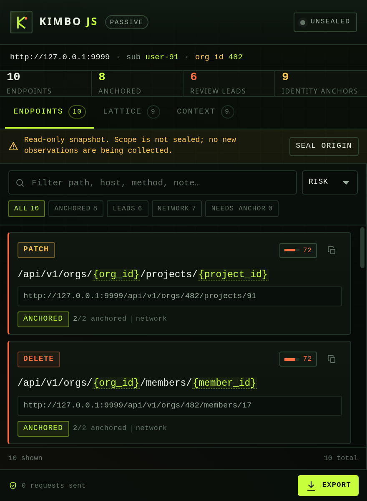
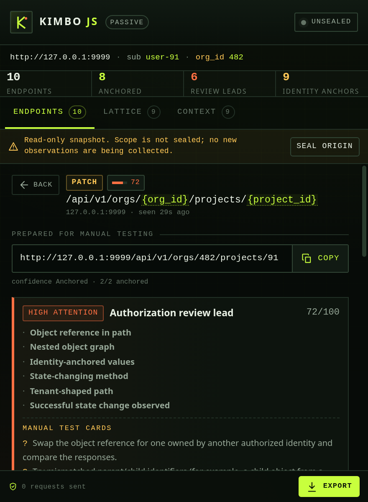
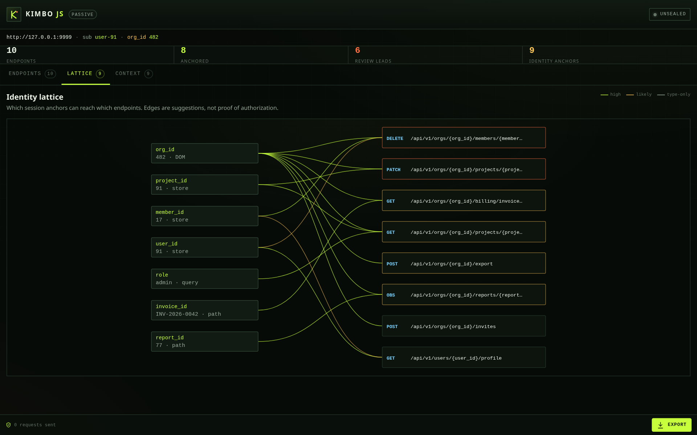
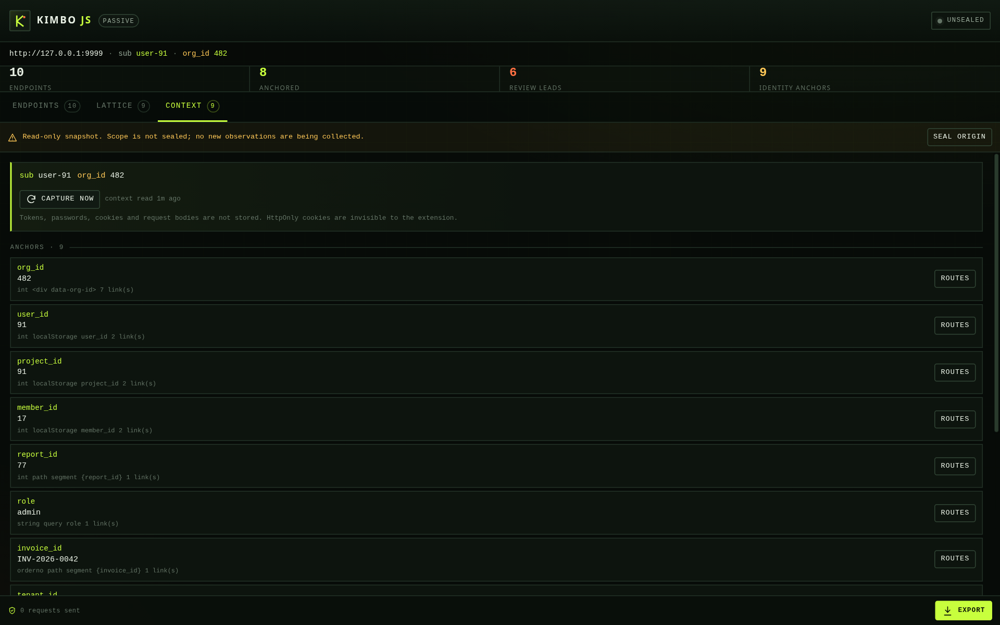

# Kimbo JS

**Passive API cartography for authorized pentests.**  
Maps the traffic the page already makes, anchors object IDs to the current session, and hands you an evidence-backed list ready for manual testing.

> Maps the surface. Never throws a punch.

Kimbo JS never calls discovered endpoints. It does not scan, fuzz, replay, or exploit. The pentester decides what to test; Kimbo prepares the handoff.



## Why this exists

Most endpoint extractors stop at a raw URL list. During a real authorized test the hard part is usually not finding `/api/orgs/{id}` — it is knowing:

- which identity anchor (`org_id`, `tenant_id`, `sub`) is active in this session;
- which observed values can plausibly fill each placeholder;
- where each value came from, and how much to trust it;
- which endpoints deserve manual authorization testing first;
- and how to hand all of that to Burp or Postman without leaking tokens.

Kimbo JS treats recon as an **evidence problem**, not a URL-count problem.

## What makes it different

1. **Evidence Ledger** — every endpoint keeps receipts: discovery source, observed methods and statuses, pages, timestamps, and the provenance of every fill.
2. **Identity Lattice** — an SVG map of session anchors → endpoints, so authorization boundaries are visible instead of implied.
3. **Human Pin** — the pentester can pin a specific context value to a placeholder. The matcher suggests; the human decides.
4. **Cache-only JS dissection** — bundles already loaded by the page are read from CacheStorage or through `fetch(..., { cache: 'only-if-cached' })`. A cache miss fails instead of touching the network. If the bundle is not cached, paste it manually.
5. **Scope Seal** — no broad `host_permissions`. A content-script pair is registered dynamically only after an explicit per-origin permission grant.
6. **Passive authorization hypotheses** — risk is framed as a manual review lead, with test cards and a disclaimer. It is never presented as a vulnerability finding.
7. **Privacy by construction** — tokens, cookies, raw bodies, response bodies and PII are never persisted. Sensitive query values are redacted before storage.

## Install

Requirements: Chrome/Chromium 111+.

1. Open `chrome://extensions`.
2. Enable **Developer mode**.
3. Click **Load unpacked** and select this directory (`kimbo-js/`).
4. Pin Kimbo JS to the toolbar.

> Recent branded Chrome builds ignore the `--load-extension` command-line flag. The repository tests load the extension through CDP `Extensions.loadUnpacked` with `--enable-unsafe-extension-debugging`; for normal use, the `chrome://extensions` flow above is simplest.

## Use it

1. Open the target in a normal tab.
2. Click the Kimbo JS toolbar icon.
3. Read the scope gate, choose whether to include same-site API hosts, and click **Seal this origin**.
4. Grant Chrome’s per-origin permission prompt.
5. Reload the page if you want to capture requests made during initial page load. For SPA routes, just navigate.
6. Browse the app normally. Log in, open list/detail screens, switch tenant if authorized.
7. Click **Capture context** after a login or tenant switch.
8. In **Context → JS bundles**, click **Read cached** to dissect already-loaded chunks, or **Paste JS** to analyze a bundle from DevTools Sources/Burp.
9. Review the ledger:
   - `Anchored` / `Likely` / `Type-only` show fill confidence.
   - Pin values you trust.
   - Read the manual test cards and evidence.
10. Export to JSON, CSV, Burp site-map URLs, Burp Repeater raw blocks, or a Postman collection.

### The scope gate

Kimbo is intentionally asleep until you seal an origin:

- **No static `content_scripts`** in the manifest.
- **No broad `host_permissions`**.
- Registration happens through `chrome.scripting.registerContentScripts` only after `chrome.permissions.request` succeeds.
- Same-site API hosts are **observed** (the page already calls them) and grouped in the ledger, but they never receive content-script injection.

### Detail view



The prepared URL, fill provenance, risk hypotheses, observed calls and field notes live together. Pins override automatic suggestions.

### Identity lattice



Each edge is a suggestion from a session anchor to an endpoint. Dashed edges are type-only guesses. Edge confidence is visible; clicking an anchor filters the route list.

### Context ledger



Anchors retain their provenance. Tokens and PII never appear. Bundles show whether they were analyzed from cache, not cached, or cross-origin.

## Permission model

| Permission | Why |
|---|---|
| `storage` | Local ledger in `chrome.storage.local`, never uploaded. |
| `scripting` | Inject collectors into a sealed origin and run the storage probe via `executeScript`. |
| `activeTab` | Identify the current tab when you open the popup. |
| `webNavigation` | Detect SPA route changes and bfcache restores. |
| `optional_host_permissions` | Ask for access to one exact origin when you seal it. No host permission is granted up front. |

Not requested: `tabs`, `cookies`, `webRequest`, `debugger`, `history`, `downloads`, `unlimitedStorage`, or broad `host_permissions`.

## Data handling

### Stored locally

- Endpoint templates, origins/hosts, observed methods, statuses, content types, timestamps.
- Non-sensitive query keys and values; sensitive values are replaced with `[redacted]`.
- Non-sensitive identity anchors: UUIDs, Mongo ObjectIds, numeric IDs, order numbers, non-sensitive storage/cookie IDs, non-sensitive JWT ID claims.
- Discovery sources, page URLs without query/fragment, bundle metadata, notes, pins.

### Never stored

- Authorization headers, bearer tokens, JWTs, API keys, passwords, CSRF tokens.
- Cookie values for sensitive names; HttpOnly cookies are invisible anyway.
- Raw request bodies or response bodies. Only ID-shaped body fields are reduced to context candidates.
- Emails, phone numbers and other PII keys/values.
- Full HTML or JavaScript text. Inline scripts are parsed locally; only candidate route strings cross the bridge.
- Page query strings, fragments or credentials in page evidence.

JWT payloads are decoded **without signature verification** and only identity-shaped claims (`sub`, `org_id`, `tenant_id`, etc.) are kept. The raw token never leaves the request hook.

Read [docs/PRIVACY.md](docs/PRIVACY.md) and [docs/SCOPE-MODEL.md](docs/SCOPE-MODEL.md) for the full model.

## Architecture

```text
page traffic                  extension boundary                 local UI
────────────                  ───────────────────                ────────
DOM / inline JS  ──┐
fetch/XHR hook  ──┼─►  content-script bus  ──►  service worker  ──►  session store
storage probe   ──┤       (batched, deduped)      (orchestration)      (per origin)
JS chunks       ──┘                                     │
                                                        ▼
                                               normalizer → scope filter
                                                        │
                                               matcher + risk hypotheses
                                                        │
                                               evidence ledger (local)
                                                        │
                                     popup / DevTools panel / exporters
```

- **Collectors** only observe. `network-hook.js` runs in the MAIN world and posts sanitized metadata; the isolated-world bridge validates it again.
- **Normalizer** is the single home for every route/ID/JWT regex; collectors do not duplicate extraction rules.
- **Matcher** scores name/type/provenance and produces bounded suggestions.
- **Pipeline** deduplicates, caps storage, prunes context, and maintains provenance.
- **Service worker** is orchestration: permissions, messaging, badges, SPA navigation, storage probes.
- **UI** reads the local session and never fetches anything.

More detail: [docs/ARCHITECTURE.md](docs/ARCHITECTURE.md).

## Export formats

| Format | Purpose |
|---|---|
| JSON ledger | Full evidence, context, fills, risk, bundles, notes. |
| CSV | One row per endpoint with prepared URL and confidence. |
| Burp site-map URLs | One prepared URL per line. |
| Burp Repeater raw blocks | Paste one raw HTTP request at a time. No auth or body. |
| Postman collection v2.1 | Folders by host/path family, one item per observed method. |

No export contains cookies, Authorization headers or request bodies. The pentester brings their own authorized session.

## Testing

```bash
python3 -I test/run_tests.py
```

The suite has **170 checks**:

- **Audit** — manifest permissions, CSP, no broad host access, no remote code, no `eval` (except the DevTools origin read), no `innerHTML`, and fetch usage restricted to the passive hook and a cache-only reader.
- **Core tests** — normalizer, matcher, risk, pipeline, exporter, redaction and pruning.
- **End-to-end** — loads the real unpacked extension in headless Chrome via CDP, seeds a ledger, exercises the popup and DevTools panel, and injects the real collector stack into a **React 18 SPA** and an **SSR** fixture.
- **No-request proof** — the fixture server logs every request:
  - the SPA makes exactly its own 7 API calls;
  - the extension adds zero API calls;
  - the dynamic chunk is fetched exactly once, proving the cache-only bundle read did not re-fetch it.

The native Chrome host-permission prompt cannot be accepted in headless mode. The scope-seal flow is therefore documented as a manual test in [docs/TESTING.md](docs/TESTING.md); all code paths before and after the prompt are covered.

Fixtures:

```bash
python3 -I test/fixtures/server.py --port 8080
# http://127.0.0.1:8080/spa.html
# http://127.0.0.1:8080/ssr.html
```

## Limitations

- Only `http:`/`https:` pages. Not `chrome://`, the Web Store, PDFs or `file://`.
- Injection is exact-origin. Same-site API hosts can appear in the ledger but are not injected; cross-registrable-domain calls are dropped and counted.
- No WebSocket/EventSource payload capture.
- No response-body analysis, by design.
- No HttpOnly cookie access.
- Cache-only bundle reading depends on the browser having a local copy. If the page’s service worker misbehaves or the bundle was served with `no-store`, use **Paste JS**.
- A page can see the sanitized `postMessage` bridge and could spoof observations. The extension validates shapes and never executes page data; polluted recon is a data-quality issue, not a code-execution boundary.
- Caps: 400 endpoints, 250 anchors, 8 calls per endpoint, 60 bundles, 30 pages per origin. Aggressive pruning runs on quota pressure.
- Risk is a triage hypothesis. It is not proof of IDOR/BOLA and not a finding.
- Kimbo is not a proxy, scanner, fuzzer or exploit tool.

## Authorized use

Use Kimbo JS only on systems you are explicitly authorized to test. Scope sealing is a technical guardrail, not a grant of authorization. You are responsible for the scope, rules of engagement and data-handling requirements of your engagement.

## Donations

If Kimbo JS saves you time on an authorized engagement and you want to support the project:

**TRON (TRC20)** — send only TRX or TRC20 tokens on the TRON network:

```
TWPxWzNMEXA4mRvimV9A4z6TmS72jyunaK
```

Verify the address on [TronScan](https://tronscan.org/#/address/TWPxWzNMEXA4mRvimV9A4z6TmS72jyunaK). Assets sent on another network cannot be recovered.

## Credits

Conceptual inspiration (no code copied):

- FindSomething (GPL-3.0) — passive page extraction and the hard lesson about re-fetching one-time-token pages.
- AtlasWiki/EndPointer (AGPL-3.0) — scope filtering and DevTools/popup presentation.
- LinkFinder (MIT) — the idea of route extraction from JavaScript.

See [NOTICE.md](NOTICE.md) for details. React 18.3.1 UMD builds are vendored only for the test fixture under their MIT license.

## License

MIT. See [LICENSE](LICENSE).

---

### Português (resumo)

**Kimbo JS** é uma extensão Chrome MV3 de reconhecimento passivo de endpoints para pentests autorizados. Ela sela uma origem com permissão explícita, observa apenas o tráfego que a página já faz, ancora IDs da sessão em placeholders e entrega um ledger com evidências para Burp/Postman. Nunca dispara requisições para endpoints descobertos. Tokens, cookies, corpos de request/response e PII não são persistidos. Leia os bundles via cache (`only-if-cached`) ou cole o JS manualmente. O risco exibido é uma hipótese de teste manual, não um achado. Licença MIT.
